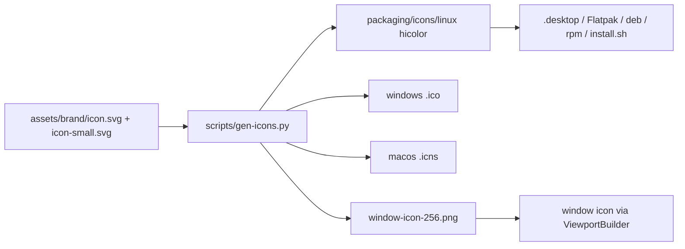

# Lumen brand

## Concept
The approved icon is a **bold, rounded play triangle with a white cursor pill** on a green tile, optically centred in a 1024 px full-bleed square. A simplified, bolder small master is used at 32 px and below. No text in the mark.

## Files
Masters live in `assets/brand/`; everything under `packaging/icons/` is generated from them. Do not edit generated files by hand.

| File | Use |
|---|---|
| `assets/brand/icon.svg` | App icon master (48 px and larger) |
| `assets/brand/icon-small.svg` | Simplified master for 32 px and smaller |
| `assets/brand/mark.svg` | Mark only, transparent |
| `assets/brand/lockup.svg` | Mark + wordmark (light text, for dark backgrounds only) |
| `packaging/icons/linux/hicolor/` | 16, 22, 24, 32, 48, 64, 128, 256, 512 px PNG + `scalable/apps/lumen-rs.svg` |
| `packaging/icons/windows/lumen-rs.ico` | 16 to 256 px |
| `packaging/icons/macos/lumen-rs.icns` | 16 to 1024 px incl. @2x (wired through `cargo packager`) |
| `packaging/icons/window-icon-256.png` | Runtime window icon, embedded by `src/main.rs` and `examples/demo.rs` |

Regenerate: `python3 scripts/gen-icons.py assets/brand/icon.svg assets/brand/icon-small.svg lumen-rs packaging/icons` (needs `rsvg-convert` and Pillow).

## Palette
| Role | Hex |
|---|---|
| Background | `#0A0C10` |
| Panel | `#11141A` |
| Raised | `#181C24` |
| Border | `#232833` |
| Text | `#E9ECF2` |
| Muted | `#8A93A6` |
| Accent mint | `#7CF0C8` |
| Accent blue | `#5B8CFF` |
| Warn | `#FFB454` |

The interface palette above is unchanged. The app icon has its own colours: green gradient `#10B981` to `#047857`, white cursor pill `#FFFFFF`; the lockup wordmark is `#F8FAFC`.

## Clear space and size
- The tile is already centred with its own margin; do not add padding in the SVG masters. Platform padding (Linux 6.25%) is applied by the generator.
- Use `icon-small.svg` at 32 px and below. The lockup is for dark backgrounds only.

## Usage

